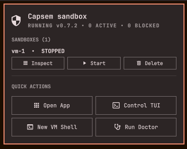

# Capsem for Omarchy

See and control your [Capsem](https://github.com/google/capsem) sandboxes from
the Omarchy bar.

Capsem runs AI agents inside hardware-isolated micro-VMs and inspects what they
send to the network. This plugin puts that on your desktop: a bar icon that
shows whether anything is running or waiting for you, a panel listing your
sandboxes, and a notification with **Approve** and **Deny** buttons when a
sandbox asks for something its policy does not already allow.



This is a community plugin. It is not part of Capsem or Omarchy, and is not
affiliated with or endorsed by Google.

## What it does

- **Bar icon.** Dimmed when the Capsem service is stopped, highlighted when an
  approval is waiting.
- **Panel.** Each sandbox with its state and its allowed and blocked request
  counts; Inspect, Start, Stop, Resume and Delete; shortcuts to the Capsem app,
  the control TUI, a new sandbox shell and `capsem doctor`.
- **Notifications.** One when a sandbox needs an approval, with Approve, Deny
  and Inspect buttons, and one when a request is blocked.

## Requirements

- Omarchy with the Quickshell-based shell (`omarchy plugin` is available)
- Capsem 0.7.2 or newer, installed and running as its user service
  (`systemctl --user status capsem`)
- `python3`, standard library only

Capsem does not publish an Arch package. See [Installing Capsem on
Omarchy](#installing-capsem-on-omarchy) below.

## Install

```bash
omarchy plugin add https://github.com/cbyrd01/omarchy-capsem.git --enable
```

Plugins run unsandboxed inside the Omarchy shell, so read the code first. It is
three files: `Panel.qml`, `Service.qml` and `bin/capsem-omarchy`.

To move the icon:

```bash
omarchy bar move io.github.cbyrd01.capsem --section right
```

### Optional extras

Neither is installed for you, because both edit files you own:

- [`extras/omarchy-menu.jsonc`](extras/omarchy-menu.jsonc): Capsem entries for
  the Omarchy launcher.
- [`extras/hyprland.lua`](extras/hyprland.lua): floats the terminal windows the
  plugin opens.

## How it works

The plugin talks only to Capsem's local gateway on `127.0.0.1`, using the port
and token Capsem writes to `~/.capsem/run/`. It makes no other network
requests and stores nothing but the counters it needs to tell a new
notification from an old one (`~/.local/state/omarchy/capsem/`).

Capsem has no way to push "an approval is waiting" or "a request was blocked"
to a client today, so the plugin polls. It does so from one shared service
rather than from each bar widget, every 5 seconds while Capsem is running (the
interval Capsem's own tray uses) and every 15 while it is stopped. A tick is
one small local request.

Names and summaries shown in the panel and in notifications are chosen by
whatever runs inside the sandbox, so they are treated as untrusted: shown as
plain text, length-limited, and escaped so they cannot put markup or a
clickable link on your desktop.

**Approving from a notification approves the request.** The notification shows
the rule and Capsem's summary of the request. If that is not enough to decide,
use Inspect and decide in the Capsem app.

## Installing Capsem on Omarchy

Capsem supports Ubuntu and Debian and publishes no Arch package. Running it
on Arch currently needs a few small fixes that are not yet released upstream,
so [`packaging/`](packaging/) builds it from source: upstream main plus those
fixes, from the `omarchy` branch of
[cbyrd01/capsem](https://github.com/cbyrd01/capsem).

You need `rustup`, `mise` and `node` on your PATH; Omarchy has the last two.
The first build takes around fifteen minutes.

```bash
cd packaging
# Build outside this folder: a build tree in here would make
# `omarchy plugin update` reject the plugin.
export BUILDDIR=~/.cache/capsem-build SRCDEST=~/.cache/capsem-build
makepkg -si      # builds and installs the capsem package
capsem-setup     # as your user: downloads the VM images, starts the service
capsem doctor    # checks KVM access and boots a test VM
```

The package adds you to the `kvm` group for access to `/dev/kvm`. That takes
effect at your next login; until then the installer grants access to the
current session directly.

Update the programs by pulling this repository and running `makepkg -si`
again. Capsem's own updater recognises a distribution package and leaves the
programs to it, while still keeping the guest VM images current
automatically (or on demand with `capsem update --assets`).

## Development

```bash
python3 -m unittest discover -s tests   # helper tests, against a stub gateway
omarchy plugin validate .               # manifest check
```

To work on a checkout live, link it into place and enable it:

```bash
ln -s "$PWD" ~/.config/omarchy/plugins/io.github.cbyrd01.capsem
omarchy-shell shell rescanPlugins
omarchy plugin enable io.github.cbyrd01.capsem
```

Saving a file reloads the plugin.

Strings live in `i18n/en.json`. To add a language, add a file named for its
Omarchy language code beside it.

## License

MIT. See [LICENSE](LICENSE).
